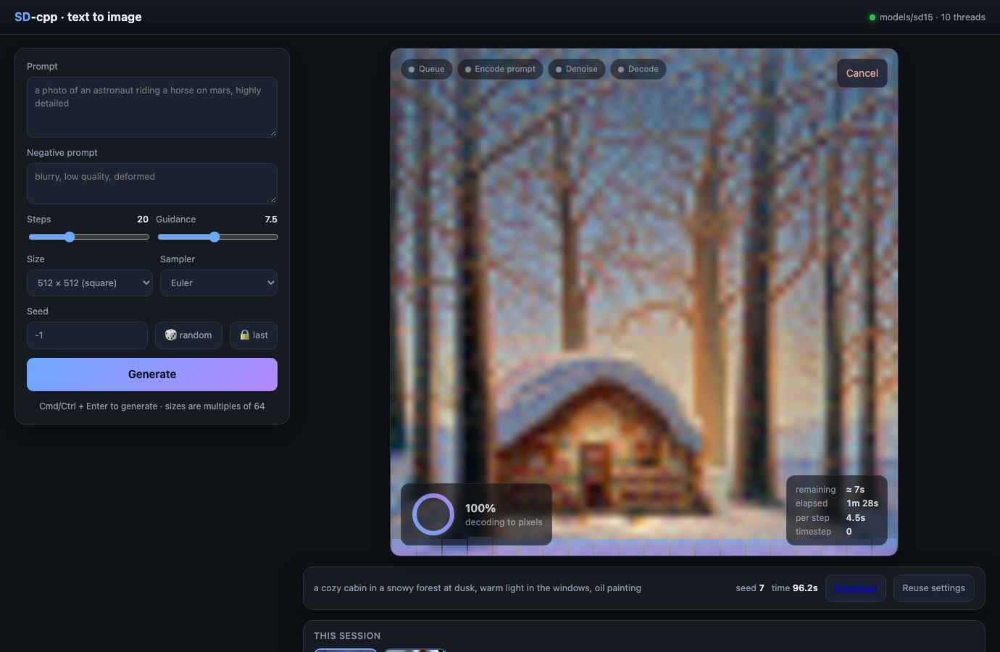

# StableDiffusion-cpp

Text-to-image inference written from scratch in C++17, running two model
families on the CPU, or on an NVIDIA GPU with the optional CUDA backend:

- **Z-Image** (`Tongyi-MAI/Z-Image-Turbo`, Apache 2.0): a 6B single-stream
  diffusion transformer with a Qwen3-4B text encoder and the FLUX VAE, among
  the strongest open-weight image models. 8 steps, no negative prompt needed.
  This is the recommended model.
- **Stable Diffusion 1.x**: the original 860M UNet model, kept for its speed
  and small size.

There are no third-party libraries. PyTorch, ONNX, image libraries and JSON
libraries are all absent; the only optional dependencies are Apple's
Accelerate framework on macOS and the CUDA toolkit for the GPU backend.
Every piece of the pipeline is implemented in `src/`:

- the numeric kernels: GEMM (float32 and bf16 weights), convolution,
  attention with grouped query heads, RMS / layer / group normalisation,
  rotary embeddings, SwiGLU
- the safetensors loader (single and sharded files) and a JSON parser
- the CLIP and Qwen byte-level BPE tokenizers
- the CLIP and Qwen3-4B text encoders, the SD UNet, the Z-Image transformer
  and the VAE decoder
- Euler, DDIM and flow-matching samplers
- a PNG writer and a small HTTP server for the web interface

On macOS the GEMM goes through Apple's Accelerate framework by default
(`make ACCELERATE=0` keeps everything hand-written); every other platform
uses the built-in kernel. On machines with an NVIDIA GPU, `make CUDA=1`
adds a CUDA backend that runs the image generator and the VAE on the GPU
(see [GPU acceleration](#gpu-acceleration)). Weights are read in the
standard Hugging Face diffusers layout, so fine-tunes of either family load
unchanged.

Beside the command-line tool there is a **web interface** (`./sd-server`,
also dependency-free) that shows the image emerging step by step while it is
generated, and a **Python fine-tuning framework** (`finetune/`) whose YAML
config decides which weights to train and that exports models the C++ code
loads directly.

| Z-Image-Turbo, 1024x1024, 9 steps, 6 minutes on an M1 Max | SD 1.5, 512x512, 20 steps, 95 seconds |
|---|---|
|  |  |

Both from `--prompt "a photo of an astronaut riding a horse on mars, highly detailed" --seed 42`.

## Contents

1. [Quick start](#quick-start)
2. [Building](#building)
3. [Model weights](#model-weights)
4. [Command-line reference](#command-line-reference)
5. [Web interface](#web-interface)
6. [GPU acceleration](#gpu-acceleration)
7. [Fine-tuning](#fine-tuning)
8. [How the models work](#how-the-models-work)
9. [Code tour](#code-tour)
10. [Component reference](#component-reference)
11. [Design decisions](#design-decisions)
12. [Performance](#performance)
13. [Testing](#testing)
14. [Extending the code](#extending-the-code)
15. [Limitations](#limitations)
16. [Troubleshooting](#troubleshooting)

Further documents:

- [docs/ADR-001-model-upgrade.md](docs/ADR-001-model-upgrade.md): why
  Z-Image was chosen over the other open-weight models, with sources and
  measurements.
- [docs/IMPROVEMENTS.md](docs/IMPROVEMENTS.md): profiling results,
  processor differences, using fine-tuned weights, and a map of where to
  change the code for speed or quality.
- [finetune/README.md](finetune/README.md): the full fine-tuning option
  reference.

## Quick start

```sh
make -j                                   # build ./sd and ./sd-server
scripts/download_zimage.sh                # Z-Image-Turbo, 33 GB, into models/z-image-turbo
./sd --model-dir models/z-image-turbo --prompt "a photo of a cat" --output cat.png
./sd-server --model-dir models/z-image-turbo    # then open http://127.0.0.1:8080/
```

Z-Image needs about 25 GB of memory. On a 10-core M1 Max a 1024x1024 image
takes about 6 minutes and a 512x512 one 85 seconds. For a smaller model:

```sh
scripts/download_sd15.sh                  # SD 1.5, 2.1 GB, into models/sd15
./sd --model-dir models/sd15 --prompt "a photo of a cat"   # 95 s at 512x512, 6 GB
```

## Building

Requirements:

- A C++17 compiler (Clang or GCC). Apple Clang on macOS works out of the box.
- `make`.
- A POSIX system, because the weight loader uses `mmap`. macOS and Linux are
  supported. Windows would need a replacement for the memory map in
  `src/safetensors.cpp`.
- Optional: the CUDA toolkit (`nvcc`, cuBLAS) for `make CUDA=1`.

Targets:

```sh
make                     # ./sd (command line) and ./sd-server (web interface)
make test                # build and run ./test_ops (kernel tests, no weights needed)
make test_tokenizer      # CLIP tokenizer test (needs models/sd15)
make test_qwen_tokenizer # Qwen tokenizer test (needs models/z-image-turbo)
make test_qwen3 test_vae test_zimage   # model tests against PyTorch dumps, see Testing
make cuda-syntax-check   # parse the CUDA backend with clang, no CUDA toolkit needed
make clean               # remove build/ and all binaries
```

Build options:

| option | effect |
|---|---|
| `make ACCELERATE=0` | macOS: use the built-in GEMM instead of Apple's Accelerate BLAS (the default on macOS, 2.6x faster for Z-Image). Elsewhere the built-in kernel is always used. |
| `make CUDA=1` | Build the NVIDIA GPU backend with `nvcc` (needs the CUDA toolkit; `CUDA_HOME` and `CUDA_ARCH=sm_86` override the defaults `/usr/local/cuda` and `native`). The binaries then pick the GPU automatically. |
| `CXX=g++ make` | use a different compiler |
| `CXXFLAGS="..." make` | replace the default `-std=c++17 -O3 -Wall -Wextra -pthread` |

On x86-64 the Makefile adds `-march=native` so the vector code uses AVX and
FMA. On arm64, NEON is used automatically.

## Model weights

| model | script | size on disk | memory in use | licence |
|---|---|---|---|---|
| Z-Image-Turbo | `scripts/download_zimage.sh [dir]` | 33 GB (fp32 transformer + bf16 text encoder, as published) | about 25 GB | Apache 2.0 |
| Stable Diffusion 1.5 | `scripts/download_sd15.sh [dir]` | 2.1 GB (fp16) | about 6 GB | CreativeML OpenRAIL-M |

Both scripts download from Hugging Face with `curl`, resume if interrupted,
and accept `HF_TOKEN` if a repository ever requires a login. The pipeline
reads `model_index.json` to tell the families apart.

### Z-Image

`models/z-image-turbo/` holds `transformer/` (3 shards, loaded as bf16),
`text_encoder/` (Qwen3-4B, 3 shards, bf16), `vae/`, `tokenizer/` and
`scheduler/`, plus their `config.json` files. The non-distilled
`Tongyi-MAI/Z-Image` for fine-tuning downloads the same way with
`ZIMAGE_REPO=Tongyi-MAI/Z-Image scripts/download_zimage.sh models/z-image`.

### Stable Diffusion 1.x

The model directory must look like this:

```
models/sd15/
  tokenizer/vocab.json                  CLIP vocabulary, 49408 entries
  tokenizer/merges.txt                  BPE merge list
  text_encoder/model.safetensors        CLIP ViT-L/14 text model, 123M params
  unet/diffusion_pytorch_model.safetensors   UNet, 860M params
  vae/diffusion_pytorch_model.safetensors    autoencoder, 84M params
```

Each `.safetensors` file may instead be named `*.fp16.safetensors`. The
full-precision name is tried first. F32, F16 and BF16 tensors are accepted
and converted to float32 at load time.

Other SD 1.x checkpoints, such as fine-tunes and DreamBooth models, work as
long as they are in diffusers format. A single-file `.ckpt` or `.safetensors`
checkpoint in the original CompVis layout must first be converted with the
diffusers conversion script, because the tensor names differ.

## Command-line reference

```
./sd --prompt TEXT [options]
```

| flag | short | default | meaning |
|---|---|---|---|
| `--prompt` | `-p` | required | what to draw |
| `--negative` | `-n` | empty | what to steer away from. Used only when guidance is on: SD 1.x with `--cfg` other than 0 or 1, the Z-Image base with `--cfg` above 0. Z-Image-Turbo ignores it |
| `--model-dir` | `-m` | `models/sd15` | diffusers-layout model directory |
| `--steps` | | 20 (SD), 9 (Z-Image) | number of sampler steps |
| `--cfg` | | 7.5 (SD), 0 (Z-Image) | guidance scale; `0` or `1` disables it. Z-Image-Turbo is trained without guidance and must use 0 |
| `--width` | `-W` | 512 (SD), 1024 (Z-Image) | image width; multiple of 64 |
| `--height` | `-H` | 512 (SD), 1024 (Z-Image) | image height; multiple of 64 |
| `--seed` | `-s` | 42 | seed for the initial noise; `-1` picks a random one and prints it |
| `--sampler` | | `euler` (SD), `flow` (Z-Image) | `euler` or `ddim` for SD 1.x; `flow` for Z-Image |
| `--threads` | `-t` | all cores | worker threads (CPU path) |
| `--device` | | `auto` | `cpu`, `cuda`, or `auto` (the GPU when built with `CUDA=1` and one is present) |
| `--output` | `-o` | `output.png` | output PNG path |
| `--help` | `-h` | | print usage |

Options that are not given take the model family's defaults. Progress goes
to stderr:

```
threads: 10
z-image models loaded in 28.2s (generator: 6155M params, cpu)
1024x1024, 9 steps, sampler flow, cfg 0
step  1/9  t=1000.00  42.4s
...
step  9/9  t= 272.73  38.4s
decoding...
seed 42, 371.7s total -> output.png
```

Practical notes:

- Z-Image's native resolution is 1024; 768 and 512 are usable for drafts
  at a quarter and a sixteenth of the cost. Prompts may be up to 512 tokens
  and can be long and descriptive. 8 or 9 steps are enough for the Turbo
  model; the non-distilled base wants 30 to 50 with `--cfg 4`.
- SD 1.x was trained at 512x512. Other sizes work, but sizes far from 512
  tend to produce duplicated subjects or poor composition. Its prompts are
  truncated at 75 tokens. 20 to 30 Euler steps, or 15 to 50 DDIM steps, give
  good results with guidance between 5 and 9.
- Both models need widths and heights that are multiples of 64.

## Web interface

```sh
./sd-server [--model-dir models/sd15] [--device auto] [--host 127.0.0.1] [--port 8080] [--threads N] [--web-dir web]
```

Open the printed address in a browser. The page has the same controls as the
command line. It reads the model family from the server and adjusts itself:
sizes, step count, guidance and the sampler list default to the loaded
model's values, and the status line shows the model and whether the CPU or
the GPU is in use.



While an image is being generated it shows:

- a **live preview** that sharpens step by step. Every step the server turns
  the predicted clean latent into a small RGB image with a fixed per-channel
  colour map (4 channels for SD, 16 for Z-Image; no VAE pass), and the page
  shows it with a blur that shrinks as the steps progress;
- a progress ring with step count, the **time remaining** estimated from the
  measured step times, elapsed time, seconds per step and the current
  timestep;
- a phase strip (queue, encode prompt, denoise, decode), a bar chart of
  per-step times, and a cancel button that stops after the current step.

Finished images appear in a strip with their settings; one click reloads
them into the form, and a Delete button (or the cross on a thumbnail)
removes an image from the server after a confirmation. The seed used for a
random-seed run is shown so an image can be reproduced. Form values persist in the browser. Reloading the page
re-attaches to a generation already in progress.

The server loads all models once (about 25 GB for Z-Image, 6 GB for SD 1.x)
and runs one generation at a time; further requests wait in a queue and the
page shows the position. Finished images are kept in memory only (the last
sixty); use Download to keep one. `--host 0.0.0.0` makes it reachable from other machines on
the network. There is no authentication, so keep it on a trusted network.

The server is written in the same dependency-free style: a small HTTP/1.1
implementation on POSIX sockets in [src/http.cpp](src/http.cpp), the
application in [src/server.cpp](src/server.cpp), and a single page in
[web/index.html](web/index.html) with no frameworks. Progress is streamed
with Server-Sent Events. The JSON API is documented at the top of
`src/server.cpp` and can be used without the page:

```sh
curl -X POST localhost:8080/api/generate -H 'Content-Type: application/json' \
     -d '{"prompt":"a red fox in snow","steps":20,"seed":-1}'        # -> {"id":"..."}
curl -N localhost:8080/api/jobs/<id>/events                           # progress stream
curl -o fox.png localhost:8080/api/jobs/<id>/image.png
curl -X DELETE localhost:8080/api/jobs/<id>                           # forget a finished job and its image
```

## GPU acceleration

```sh
make CUDA=1 -j                 # needs nvcc; links cudart and cublas
./test_ops                     # now also compares every op on the GPU with the CPU result
./sd --model-dir models/z-image-turbo --prompt "..."       # uses the GPU (--device cpu to compare)
```

With `CUDA=1`, every tensor operation has a GPU implementation in
[src/backend_cuda.cu](src/backend_cuda.cu): matrix products through cuBLAS
(bf16 tensor cores for the bf16 weights, float32 otherwise), and plain
kernels for convolution (im2col), attention, the normalisations, rotary
embeddings, activations and reshapes. The CPU code is untouched; a tensor
carries a device, each op dispatches on it, and `--device cpu` runs the
same binary without the GPU.

What runs where: the image generator (UNet or Z-Image transformer) and the
VAE decoder live on the GPU with their weights resident (3.4 GB for SD 1.5,
12.3 GB bf16 for Z-Image). The text encoders stay on the CPU, since they take
well under a second per prompt and would cost 8 GB of GPU memory. Only the
latent (at most 1 MB) crosses the bus each step, so the sampler and the live
previews work as before.

Expectations: the two heavy workloads are GEMM and attention, which is what
GPUs do best. On a card in the RTX 3080 to 4090 class, a Z-Image step should
take about one second at 1024x1024 against 38 seconds on the M1 Max CPU; the
first step includes cuBLAS warm-up. A 16 GB card fits Z-Image at 1024x1024;
8 GB fits SD 1.5. `SD_CUDA_TF32=1` allows TF32 tensor cores for the float32
products (SD 1.5), roughly twice as fast with about 1e-3 relative error.

Validation: `./test_ops` runs every op on both devices with the same inputs
and prints a `cuda <op>  max|err|` line for each. As an end-to-end check,
the same prompt and seed with and without `--device cpu` should give images
that differ only by float rounding.

Status: the backend was written and parse-checked on a Mac without an
NVIDIA GPU (`make cuda-syntax-check` runs that check with clang and
stand-in headers), and has not yet run on real hardware. The first run is
the acceptance test. If an op fails there, its kernel is a few lines in
`backend_cuda.cu`, and the CPU version it must match is in `tensor.cpp`.

## Fine-tuning

The C++ code only runs models. To change what a model draws, train in
PyTorch with the framework in [finetune/](finetune/README.md) and point
`./sd` at the export:

```sh
pip install -e finetune
python finetune/scripts/make_sample_dataset.py data/sample-shapes   # or use your own images + captions
sdft inspect finetune/configs/zimage_lora.yaml                      # shows exactly which weights will train
sdft train   finetune/configs/zimage_lora.yaml                      # LoRA on the Z-Image transformer
./sd --model-dir models/z-image-lora --prompt "..."
```

`finetune/configs/lora.yaml` and `full.yaml` do the same for SD 1.x. For
Z-Image, train on the non-distilled `Tongyi-MAI/Z-Image` base; the Turbo
weights are distilled and adapt poorly.

The YAML `weights` section chooses the method (LoRA adapters or full
weights), which components train (UNet, text encoder), per-component
learning rates, regular expressions that include or exclude layers by name,
and the LoRA rank, scale and target layers. Training options include mixed
precision, gradient checkpointing, min-SNR loss weighting, EMA, latent
caching, checkpoints with resume and periodic sample images. Export merges
adapters into the weights and writes a complete diffusers directory, so both
this project and `diffusers` can load the result.

## How the models work

Both models are *latent* diffusion models. Rather than denoising pixels,
they denoise a small latent image 8 times smaller than the output (4
channels for SD, 16 for Z-Image), and a separate decoder turns the final
latent into pixels. The text goes in through a frozen language model: CLIP
for SD 1.x, the Qwen3-4B decoder for Z-Image.

### Z-Image

```
prompt ──> chat template ──> QwenTokenizer ──> Qwen3-4B (35 of 36 layers) ──> text states [L, 2560]
                                                                                   │
noise [16, H/8, W/8] ──> for each of 9 steps:  out = Transformer(x, t = 1 - sigma, text) ──> x += (sigma - sigma_next) * out
                                                                                   │
x / 0.3611 + 0.1159 ──> VAEDecoder (FLUX) ──> RGB in [-1, 1] ──> PNG
```

The transformer cuts the latent into 2x2 patches and processes image and
text tokens as one sequence, so every image patch attends to every word and
to every other patch. It is trained with *flow matching*: the noisy latent is
a straight-line mix `x = (1 - sigma) * x0 + sigma * noise`, and the model
predicts the direction from noise to image. The Turbo checkpoint was
distilled to need only 8 or 9 such steps and no guidance pass, which is
why a 6B model is affordable on a CPU.

### Stable Diffusion 1.x

```
prompt ──> CLIPTokenizer ──> CLIPTextEncoder ──┐ context [2, 77, 768]
                                               v
noise ──> for each step:  x_in = scale(x) ──> UNet(x_in, t, context) ──> eps ──> sampler step ──> x
                                               ^
                                               └─ guidance: eps = eps_u + cfg * (eps_c - eps_u)
x / 0.18215 ──> VAEDecoder ──> RGB in [-1, 1] ──> PNG
```

1. **Text encoding.** The prompt is split into at most 77 CLIP tokens
   (start token, up to 75 text tokens, end token, then end-token padding).
   The CLIP text transformer turns them into 77 vectors of 768 features. The
   negative prompt, or an empty string, is encoded the same way.
2. **Initial noise.** A latent of shape `[1, 4, H/8, W/8]` is filled with
   Gaussian noise, scaled by the sampler's initial sigma.
3. **Denoising loop.** At each step the UNet predicts the noise in the
   current latent. It runs once with the negative-prompt embedding and once
   with the prompt embedding, as a single batch of two. Classifier-free
   guidance extrapolates from the unconditional prediction towards the
   conditional one by the factor `cfg`. The sampler then uses this noise
   estimate to move the latent to the next, less noisy timestep.
4. **Decoding.** The final latent is divided by the training scale factor
   0.18215 and passed through the VAE decoder, which upsamples it 8x to RGB.

The diffusion process itself is defined in `src/scheduler.h`. Training used
1000 noise levels with a "scaled linear" schedule. A noisy latent at level
`t` is `x_t = sqrt(a_t) * x_0 + sqrt(1 - a_t) * eps`, where `a_t` is the
cumulative product of `1 - beta`. The samplers visit a short subsequence of
these levels.

## Code tour

```
src/
  backend_cuda.h / .cu   GPU implementations of every op (cuBLAS + kernels); backend_cuda_stub.cpp without CUDA
  pipeline.h / .cpp      Pipeline: model family detection, device choice, models kept in memory, generate()
  zimage.h / .cpp        Z-Image single-stream diffusion transformer (S3-DiT)
  qwen3.h / .cpp         Qwen3 decoder-only language model, used as the Z-Image text encoder
  qwen_tokenizer.h/.cpp  Qwen byte-level BPE tokenizer with the chat template
  http.h / .cpp          minimal HTTP/1.1 server with streamed responses
  server.cpp             sd-server: JSON API, job queue, live previews
  tensor.h / .cpp        Tensor type (f32 / bf16, CPU or CUDA), thread pool, GEMM, every operator with device dispatch
  json.h / .cpp          minimal JSON parser
  safetensors.h / .cpp   weight file loader with F16/BF16 conversion
  tokenizer.h / .cpp     CLIP byte-level BPE tokenizer
  modules.h / .cpp       reusable layers bound to weights by name
  clip.h / .cpp          CLIP text encoder
  unet.h / .cpp          UNet2DConditionModel
  vae.h / .cpp           AutoencoderKL decoder
  scheduler.h / .cpp     beta schedule, Euler and DDIM samplers; flow-matching sampler
  image.h / .cpp         PNG encoder and base64
  main.cpp               CLI on top of Pipeline
web/
  index.html             the web interface, one file, no frameworks
finetune/
  sdft/                  Python fine-tuning framework (see finetune/README.md)
  configs/               zimage_lora.yaml, zimage_smoke.yaml; lora.yaml, full.yaml, smoke.yaml for SD 1.x
  scripts/               make_sample_dataset.py, dump_reference.py (PyTorch reference tensors)
docs/
  ADR-001-model-upgrade.md   model choice; IMPROVEMENTS.md   profiling and code map
tests/
  test_ops.cpp           kernel tests against naive references (and GPU vs CPU with CUDA), GEMM benchmarks
  test_tokenizer.cpp     CLIP tokenizer tests against known token ids
  test_qwen_tokenizer.cpp  Qwen tokenizer against fixtures from the Hugging Face tokenizer
  test_qwen3.cpp, test_vae.cpp, test_zimage.cpp   each model against a PyTorch reference dump
  fixtures/              tokenizer fixtures; reference dumps are generated locally
  cuda_stub/             stand-in CUDA headers for make cuda-syntax-check
scripts/
  download_zimage.sh     Z-Image weight downloader (ZIMAGE_REPO selects Turbo or the base)
  download_sd15.sh       SD 1.5 weight downloader
examples/                sample outputs shown above
```

Dependencies flow strictly upwards:

```
main.cpp, server.cpp ──> pipeline ──┬── zimage, qwen3, clip, unet, vae ──> modules ──> safetensors ──> json
                        (server.cpp │                                        └──────> tensor ──> backend_cuda
                         also http) ├── qwen_tokenizer, tokenizer ──> json
                                    ├── scheduler ──> tensor
                                    └── image
```

`backend_cuda` is either the CUDA implementation or a stub, chosen at build
time; nothing above `tensor` knows which.

Suggested reading order for a review:

1. `src/tensor.h`, for the data model and operator contracts.
2. `src/pipeline.cpp`, for both end-to-end pipelines.
3. `src/zimage.h` and `src/qwen3.h`, which describe the Z-Image
   architecture in their header comments.
4. `src/modules.h`, `src/unet.h`, `src/clip.h` and `src/vae.h`, for the SD
   layers and model layouts.
5. `src/scheduler.h`, for the sampling maths.
6. `src/tensor.cpp`, for how the CPU kernels are implemented, and
   `src/backend_cuda.cu` for their GPU counterparts.

Every header documents its public API. Every source file starts with a
summary and comments its non-obvious steps.

## Component reference

### Tensor and operators (`src/tensor.h`)

`Tensor` is a shape plus contiguous row-major storage. It has two element
types and two devices, and no strides or views:

- **dtype**: F32, or BF16 for large model weights (half the memory; only
  `linear` and `embedding` accept BF16 inputs, and activations are always
  F32).
- **device**: CPU (`std::vector` storage) or CUDA (a GPU allocation).
  Every operator checks that its inputs share a device and runs the matching
  implementation; `to(Device)` copies across.

Operators return new tensors, except those whose names end in `_`, which
work in place.

Two activation layouts are used:

| layout | shape | used by |
|---|---|---|
| NCHW | `[batch, channels, height, width]` | convolution, group norm, upsampling, skip concatenation |
| NLC | `[batch, tokens, features]` | linear layers, layer norm, attention |

`nchw_to_nlc` and `nlc_to_nchw` convert between them inside each
transformer block.

| operator | semantics |
|---|---|
| `gemm_nt(M, N, K, A, lda, B, ldb, C, ldc, bias, accumulate)` | `C = A * B^T (+ bias)`; the core of everything below |
| `linear(x, W, b)` | `nn.Linear`: `x[..., in] -> [..., out]` |
| `conv2d(x, W, b, stride, pad)` | `nn.Conv2d` via im2col + GEMM |
| `group_norm(x, groups, gamma, beta, eps)` | `nn.GroupNorm` |
| `layer_norm(x, gamma, beta, eps)` | `nn.LayerNorm` over the last dimension |
| `rms_norm(x, gamma, eps)`, `rms_norm_heads_` | RMS normalisation per row, or per head (QK-norm) |
| `attention(q, k, v, heads, causal, kv_heads)` | multi-head `softmax(Q K^T / sqrt(d)) V`, with grouped-query sharing when `kv_heads < heads` |
| `rope_(x, dim, cos, sin, interleaved)` | rotary position embedding, rotate-half (Qwen) or interleaved (Z-Image) convention |
| `geglu(x)`, `swiglu(gate, up)` | gated activations of the SD and Z-Image feed-forward layers |
| `embedding(table, ids)` | row lookup in an F32 or BF16 table |
| `silu_`, `gelu_`, `quick_gelu_`, `add_`, `scale_`, `affine_` | in-place elementwise ops |
| `mul_rows_`, `add_rows_scaled_`, `add_channel_bias_` | broadcasts for adaLN modulation and time embeddings |
| `upsample_nearest2x`, `concat_channels`, `concat_batch`, `slice_batch`, `repeat_batch`, `slice_rows`, `patchify2d`, `unpatchify2d` | shape helpers |

Threading uses one global pool. `parallel_for(n, fn)` hands out item indices
dynamically from an atomic counter and the calling thread joins in.
`parallel_chunks(n, min_chunk, fn)` hands out contiguous ranges for cheap
elementwise loops. Neither is re-entrant, so operators parallelise at one
level only.

### GEMM kernel (`src/tensor.cpp`)

All of the arithmetic intensity in Stable Diffusion is in matrix multiplies:
linear layers, convolutions after im2col, and attention. One kernel handles
all of them, and it always takes the second operand transposed. That is the
natural layout here, because PyTorch stores linear weights as `[out, in]`,
im2col rows are `[pixels, K]`, and attention computes `Q K^T`.

The kernel splits C into 64x128 tiles, one task per tile, so threads never
share output. Inside a tile it walks K in slices of 128 for cache reuse. The
micro-kernel computes a 4x4 block of C with 16 four-lane vector accumulators,
written with Clang/GCC vector extensions so that the same source becomes
NEON or SSE/AVX. It reaches about 550 to 600 GFLOP/s on a 10-core M-series
CPU. There is no operand packing, which keeps the code short at some cost in
peak speed.

`gemm_nt_bf16` takes BF16 weights: each task expands its tile of B to
float32 in a thread-local buffer and runs the same micro-kernel, so
conversion costs about 1/64 of the arithmetic. On macOS, where the default
build uses Accelerate, both entry points go to `cblas_sgemm` instead (the
BF16 one after expanding the weight), which reaches about 2 TFLOP/s on the
M1 Max.

### Convolution

`conv2d` uses im2col. Each output pixel's input patch is copied into one row of
a scratch matrix, ordered `(input channel, ky, kx)`. That ordering matches
PyTorch's `[Cout, Cin, kh, kw]` weight layout, so the weight is used directly
as a `[Cout, K]` matrix. A single GEMM then writes the NCHW output. Pixels
are processed in chunks so the scratch matrix stays at or below 64 MB; a
full-image im2col in the VAE's last stage would need more than 2 GB.

### Attention

`attention` loops over heads. For each head it computes the full score matrix
`Q_h K_h^T`, applies a numerically stable softmax in place, transposes `V_h`,
and multiplies. The heads are strided slices of the projected tensors, so no
reshaping copies are needed. With grouped-query attention (Qwen3: 32
query heads, 8 key/value heads) consecutive query heads read the same key
and value slice. For Z-Image at 1024x1024 the joint sequence is 4,096 image
tokens plus the padded prompt, so the score matrix is at most about 4,600 x
4,600 floats, or 85 MB per head. There is no flash-attention style tiling.

### Weight loading (`src/safetensors.h`)

A `.safetensors` file is an 8-byte header length, a JSON header that
describes each tensor's dtype, shape and byte range, and then raw data.
`Weights::load_safetensors` memory-maps the file, parses the header,
allocates every tensor, and converts them in parallel: to float32 by
default, or, with `keep_bf16`, large tensors to BF16 (the Z-Image models)
while norms and biases stay float32. Half precision conversion is
bit-exact, including subnormals, infinities and NaN. Tensors of other dtypes
are skipped with a message; the only such tensor is CLIP's integer
`position_ids` buffer, which is not needed.

`Weights::load_model(dir, base)` finds `base.safetensors`, a sharded set
listed in `base.safetensors.index.json`, or the `.fp16` variant.
`Weights::to_device(Device::CUDA)` moves every tensor to the GPU.

`Weights` maps names to tensors. Model classes keep raw pointers into it, so
it must outlive them. `Pipeline` owns one `Weights` per model and keeps them
loaded for its lifetime.

### Tokenizer (`src/tokenizer.h`)

`CLIPTokenizer` reproduces the tokenizer of `openai/clip-vit-large-patch14`:

1. Lower-case the text.
2. Split it the way CLIP's regex does, into special tokens, contractions such
   as `'s`, runs of letters, single digits, and runs of other symbols.
   Whitespace is dropped.
3. Map every byte of a piece to a printable Unicode stand-in using GPT-2's
   `bytes_to_unicode` table, and append `</w>` to the last symbol.
4. Merge adjacent symbol pairs greedily, lowest `merges.txt` rank first.
5. Look up each final symbol in `vocab.json`.

`encode()` wraps the ids as `[49406] ids [49407] [49407]...` to exactly 77
tokens. SD 1.x pads with the end token rather than a separate pad token.

### Modules (`src/modules.h`)

Each module mirrors a diffusers class and binds weights by name prefix. For
example, `Linear(w, "mid_block.attentions.0.proj_in")` reads
`mid_block.attentions.0.proj_in.weight` and the optional `.bias`. Modules hold
pointers into the weights, own no memory, and have `const` forward passes.

| module | diffusers class | computation |
|---|---|---|
| `ResnetBlock` | `ResnetBlock2D` | `conv2(silu(norm2(conv1(silu(norm1(x))) + temb))) + shortcut(x)` |
| `CrossAttention` | `Attention` | `to_out(attention(to_q(x), to_k(ctx), to_v(ctx)))` |
| `FeedForward` | `FeedForward` (GEGLU) | `out(geglu(proj(x)))`, widening 4x inside |
| `BasicTransformerBlock` | `BasicTransformerBlock` | self-attention, cross-attention, feed-forward, each pre-norm with a residual |
| `Transformer2D` | `Transformer2DModel` | group norm, `proj_in`, blocks, `proj_out`, plus residual |
| `VAEAttention` | VAE mid-block `Attention` | single-head self-attention over pixels |

### CLIP text encoder (`src/clip.h`)

A 12-layer, 768-wide, 12-head pre-norm transformer with causal self-attention
and quick-GELU MLPs. It takes the 77 token ids and returns the final hidden
state `[1, 77, 768]` after the last layer norm. SD 1.x conditions on all 77
positions, not on the pooled output.

### UNet (`src/unet.h`)

The UNet predicts noise from a latent, a timestep and the text context.
For a 512x512 image, with a 64x64 latent:

| stage | contents | channels | resolution |
|---|---|---|---|
| `conv_in` | 3x3 conv | 4 -> 320 | 64 |
| down 0 | 2 x (resnet + transformer), downsample | 320 | 64 -> 32 |
| down 1 | 2 x (resnet + transformer), downsample | 640 | 32 -> 16 |
| down 2 | 2 x (resnet + transformer), downsample | 1280 | 16 -> 8 |
| down 3 | 2 x resnet | 1280 | 8 |
| mid | resnet, transformer, resnet | 1280 | 8 |
| up 0 | 3 x resnet, upsample | 1280 | 8 -> 16 |
| up 1 | 3 x (resnet + transformer), upsample | 1280 | 16 -> 32 |
| up 2 | 3 x (resnet + transformer), upsample | 640 | 32 -> 64 |
| up 3 | 3 x (resnet + transformer) | 320 | 64 |
| out | group norm, SiLU, 3x3 conv | 320 -> 4 | 64 |

The timestep is encoded as 320 sinusoidal features (cosines then sines) and
passed through a two-layer MLP to 1280 features. Each resnet adds a
projection of this embedding to every pixel. Down-path outputs are pushed
onto a stack of 12 skip tensors, and each up-path resnet pops one and
concatenates it to its input along the channel axis.

The constructor discovers block counts, attention placement and channel
widths from the weight names and shapes. Nothing is hard-coded except the
head count of 8 and the GroupNorm settings.

### VAE decoder (`src/vae.h`)

Only the decoder is implemented, because text-to-image never encodes an
image. It applies `post_quant_conv` and `conv_in` to reach 512 channels, a
mid block with single-head self-attention, then four up blocks of three
resnets each, the first three of which upsample 2x. A final group norm, SiLU
and conv produce RGB in roughly `[-1, 1]`. `Pipeline::generate` maps this to
`[0, 255]` with clamping.

### Samplers (`src/scheduler.h`)

Both samplers share the training schedule: 1000 betas spaced linearly in
square-root space between 0.00085 and 0.012, and their cumulative product
`alpha_bar`.

**Euler** (`--sampler euler`) matches diffusers' `EulerDiscreteScheduler`
with linspace timesteps. It works in terms of
`sigma = sqrt((1 - alpha_bar) / alpha_bar)` and the unscaled latent
`x = x_0 + sigma * eps`. One step is `x += eps * (sigma_next - sigma)`.
Before each UNet call, the latent is divided by `sqrt(sigma^2 + 1)` to
recover the input distribution the UNet was trained on. The initial noise is
scaled by the largest sigma, about 14.6.

**DDIM** (`--sampler ddim`) matches diffusers' `DDIMScheduler` with eta 0,
leading spacing and `steps_offset = 1`. It predicts the clean latent from the
noise estimate and re-noises it to the next level deterministically:

```
x0     = (x_t - sqrt(1 - a_t) * eps) / sqrt(a_t)
x_prev = sqrt(a_prev) * x0 + sqrt(1 - a_prev) * eps
```

### Z-Image (`src/zimage.h`, `src/qwen3.h`, `src/qwen_tokenizer.h`)

The Qwen tokenizer wraps the prompt in the chat template
(`<|im_start|>user ... <|im_end|> <|im_start|>assistant`) and tokenises it
with Qwen's byte-level BPE and pre-tokenisation rules. The Qwen3-4B decoder
(36 layers, grouped-query attention with 32 query and 8 key-value heads,
rotary positions, SwiGLU) runs 35 of its 36 layers, because Z-Image
conditions on the penultimate hidden state.

The transformer embeds 2x2 latent patches and the text states into a 3840-wide
stream, refines each with two blocks, and runs 30 joint blocks over the
concatenated sequence. Each block is modulated by a 256-dim timestep
embedding (scale and tanh-gated residuals), uses RMS-normalised queries and
keys, three-axis rotary positions (sequence, row, column), and a SwiGLU
feed-forward. Sequences are padded to a multiple of 32 with learned pad
tokens that take part in attention. Weights stay bf16 in memory and are
expanded to float32 inside the GEMM.

The flow-matching sampler uses sigmas from 1 to 1/N shifted by the
scheduler's `shift` (3.0), feeds the model `t = 1 - sigma`, and takes Euler
steps towards the model's prediction of `x0 - noise`.

### PNG writer (`src/image.h`)

`encode_png` produces an 8-bit RGB PNG with three chunks: IHDR, IDAT and
IEND; `write_png` saves it to a file. The pixel data uses deflate "stored"
blocks, which are uncompressed, so no zlib is needed. A 512x512 image is
about 790 KB. `base64_encode` lets the server embed the small per-step
previews in its progress events.

### Pipeline and server (`src/pipeline.h`, `src/http.h`, `src/server.cpp`)

`Pipeline` reads `model_index.json` to pick the family, loads the tokenizer
and models once, places the generator and VAE on the requested device, and
exposes `generate(params, progress)` and `defaults()`. The progress callback is called before text
encoding, after every sampler step (with the step time and the predicted
clean latent), and before decoding; returning `false` cancels after the
current step. `latent_to_rgb` turns a latent into a rough RGB preview with
fixed per-channel weights, without running the VAE.

`http::Server` is a minimal HTTP/1.1 server: one thread per connection,
exact or prefix routes, JSON and streamed responses, and request size limits.
`server.cpp` builds the application on it: a FIFO job queue with one worker
thread, Server-Sent Events that replay a job's history to late subscribers,
cancellation, and an in-memory gallery of the last sixty results.

## Design decisions

- **Readability over peak speed.** Every operator is a plain loop or a call
  to the one GEMM. There is no graph compiler, operator fusion, or
  hand-written assembly.
- **float32 arithmetic, bf16 storage where it matters.** All activations and
  arithmetic are float32. SD weights are expanded to float32 in memory (3.4
  GB for the UNet); the 6B Z-Image transformer and 4B text encoder stay bf16
  (20 GB instead of 40) and are expanded inside the GEMM.
- **Structure from weights.** Models discover block counts and widths from
  tensor names and shapes, so fine-tunes load unchanged. The few
  hyper-parameters weights cannot reveal (Z-Image head count, rotary bases,
  VAE scale and shift, sampler shift) are read from the `config.json` files.
- **Verified against the reference.** Each Z-Image component is compared
  with the PyTorch implementation on identical inputs, and a trace facility
  locates divergences block by block.
- **Models stay loaded.** `Pipeline` keeps all components resident (25 GB for
  Z-Image, 6 GB for SD 1.5) so the server can answer many requests; the
  command-line tool pays the same cost for one image.
- **One code path, two devices.** Tensors carry their device and each
  operator dispatches on it, so the model code is written once and the CPU
  path stays exactly as it was when the GPU backend is not built.
- **Batched guidance.** For SD the conditional and unconditional UNet passes
  run as one batch of two, so weights are read once per step. Z-Image-Turbo
  needs no guidance pass at all.

## Performance

Measured on an Apple M1 Max (8 performance and 2 efficiency cores).

Z-Image-Turbo with the default macOS build (Accelerate):

| | 512 x 512 | 1024 x 1024 |
|---|---|---|
| one transformer step | 8.2 s | 38.4 s |
| full image, 9 steps and decode | 85 s | 372 s |
| peak memory | 22 GB | 25 GB |

With the built-in GEMM (`make ACCELERATE=0`) a 512x512 image takes 220 s.

Stable Diffusion 1.5 with the built-in GEMM (with Accelerate a step takes
2.5 s instead of 4.3 s):

| stage | time |
|---|---|
| load and run the text encoder | 0.2 s |
| load the UNet weights, after the first run warms the page cache | 0.4 s |
| one UNet step with guidance at 512x512 | 4.3 s |
| VAE decode and PNG write at 512x512 | 7.2 s |
| full 20-step image | about 94 s |

Peak memory footprint at 512x512 is about 6.0 GB with all three models
loaded in float32.

These numbers come from an Apple M1 Max and will differ on other processors.
[docs/IMPROVEMENTS.md](docs/IMPROVEMENTS.md) has the full profile, the
reasons results vary between machines, and a code map for making the models
faster or better. GPU timings are estimates until the CUDA backend has been
measured on hardware; see [GPU acceleration](#gpu-acceleration).

Ways to make it faster, roughly in order of payoff:

- Build with `make CUDA=1` on a machine with an NVIDIA GPU.
- On macOS, keep the default Accelerate build; `ACCELERATE=0` is 2.6x slower
  for Z-Image.
- Draft Z-Image at 512x512 (85 s), then render the keeper at 1024x1024.
- For SD, use `--cfg 1` to skip the unconditional pass at a cost in prompt
  adherence, use fewer steps (DDIM is usable at 15), or a smaller size.

## Testing

```sh
make test                 # kernel tests
make test_tokenizer && ./test_tokenizer [model-dir]
make test_qwen_tokenizer && ./test_qwen_tokenizer      # needs models/z-image-turbo/tokenizer
python finetune/tests/test_config.py && python finetune/tests/test_lora.py   # fine-tuning framework
```

The three Z-Image models are checked against PyTorch on the same inputs.
`finetune/scripts/dump_reference.py` writes reference tensors with the
`diffusers` and `transformers` implementations, and the C++ tests compare:

```sh
python finetune/scripts/dump_reference.py text && make test_qwen3 && ./test_qwen3     # relative error 1.4e-6
python finetune/scripts/dump_reference.py vae && make test_vae && ./test_vae          # 1.1e-6
python finetune/scripts/dump_reference.py transformer && make test_zimage && ./test_zimage   # 6e-6
```

Setting `ZIMAGE_TRACE=<prefix>` makes the transformer write its intermediate
tensors, which the dump script also records, so a divergence can be located
block by block.

`test_ops` compares the CPU kernels (float32 and bf16 GEMM, `conv2d`,
attention including grouped-query and causal, group/layer/RMS norms, both
rotary conventions, SwiGLU, bf16 rounding) against naive double-precision
references on random inputs, with odd sizes and padded leading dimensions
to exercise the edge-tile and stride paths. When built with `CUDA=1` and a
GPU is present it also runs every operator on the GPU and compares with the
CPU result. It ends with two GEMM benchmarks, needs no weights, and exits
non-zero on any failure.

`test_tokenizer` checks case folding, contractions, digits, punctuation runs,
empty input and the 77-token padding against ids from the real vocabulary.

The Python tests check the strict config loader (unknown keys, type errors,
overrides, nested defaults) and the LoRA implementation (zero-initialised
adapters leave outputs unchanged, merging reproduces the adapted outputs,
save and load round-trip).

End-to-end correctness was checked by generating the example images above,
by exercising every server endpoint with `curl` and headless Chrome, and by
training LoRAs with `finetune/configs/smoke.yaml` and `zimage_smoke.yaml`,
exporting them, and generating from the exports with `./sd`. An untrained
SD model passed through the export produces pixel-identical output to the
original weights. The Z-Image components are compared tensor by tensor with
PyTorch as above; the SD 1.5 pipeline has only been checked by its output
images.

## Extending the code

- **New operator.** Declare it in `src/tensor.h` with a comment describing
  shapes, implement it in `src/tensor.cpp` using `parallel_for` or
  `parallel_chunks`, and add a reference check to `tests/test_ops.cpp`. For
  GPU support, add a function to `src/backend_cuda.h`, its kernel to
  `src/backend_cuda.cu`, a throwing stub to `src/backend_cuda_stub.cpp`, a
  dispatch at the top of the CPU version, and a line to `test_cuda` in
  `tests/test_ops.cpp`.
- **New sampler.** Subclass `Scheduler` in `src/scheduler.h`, implement
  `set_timesteps` and `step`, and override `init_noise_sigma` and
  `scale_model_input` if the sampler works in sigma space. Register it in
  `make_scheduler`.
- **Image-to-image.** Implement the VAE encoder in `src/vae.cpp` with the
  same modules as the decoder, encode the input image, noise it to an
  intermediate timestep, and start the sampling loop from there.
- **SD 2.x.** Change the UNet head count to use a fixed head dimension of 64,
  swap the text encoder for OpenCLIP ViT-H with penultimate-layer output, and
  add v-prediction to the samplers.
- **Faster kernels.** Everything heavy goes through `gemm_nt` and
  `gemm_nt_bf16`, so packing or larger register tiles there speed up both
  models on the CPU. On the GPU, the next step is a fused (flash) attention
  kernel in place of the per-head score matrix.
- **Another model family.** Add its components beside `zimage.cpp`, a
  `Family` value and a `generate_*` function in `pipeline.cpp`, and a
  reference test in the style of `test_zimage.cpp`.

## Limitations

- Float32 activations everywhere; no fp16 or quantised compute. The CUDA
  backend has not yet been run on real hardware (see GPU acceleration).
- The CLIP pre-tokeniser treats every non-ASCII code point as a letter, and
  lower-casing only affects ASCII. The Qwen tokenizer classifies the common
  punctuation, symbol and emoji blocks and matches the reference on CJK
  text, but has no full Unicode tables and no NFC normalisation.
- Prompt weighting syntax such as `(word:1.2)` is not parsed; it is tokenised
  as plain text.
- SD 2.x, SDXL, FLUX and SD 3 are not supported; Z-Image and SD 1.x are.
- Z-Image needs about 25 GB of memory, since the text encoder and the
  transformer stay loaded together.
- Random numbers come from `std::mt19937_64`, so a seed does not reproduce
  the image a PyTorch pipeline makes with the same seed.
- Only text-to-image is implemented. There is no image-to-image, inpainting
  or ControlNet support. LoRA adapters must be merged into the weights, which
  the fine-tuning framework's export does.
- The web server has no authentication or TLS; it is meant for localhost or a
  trusted network.

## Troubleshooting

| message | cause and fix |
|---|---|
| `cannot find models/sd15/unet/diffusion_pytorch_model[.fp16].safetensors` | Weights are missing or `--model-dir` is wrong. Run `scripts/download_sd15.sh`. |
| `missing weight: <name>` | The checkpoint is not in diffusers SD 1.x layout. Convert it with the diffusers conversion script. |
| `concat_channels: [...] vs [...]` | Width or height is not a multiple of 64. |
| Process is killed, or the machine swaps heavily, with Z-Image | It needs about 25 GB free. Close other large programs, or use SD 1.5. |
| `Z-Image: ...` or `Qwen3: ...` errors at load | The directory is incomplete; rerun `scripts/download_zimage.sh`, which resumes. |
| `CUDA requested but not available` | The binary was built without `CUDA=1`, or no NVIDIA device is visible; use `--device cpu` or rebuild. |
| `CUDA error in cudaMalloc` | The GPU is out of memory; use a smaller size, SD 1.5, or close other GPU programs. |
| `cannot open .../vocab.json` | The tokenizer files are missing from the model directory. |
| Very slow generation | Check that `threads:` on the first line matches your core count, that the model line ends with `cuda` if you expect the GPU, and that no other heavy process is running. On macOS, check the build did not use `ACCELERATE=0`. |
| `cannot bind 127.0.0.1:8080` | Another process uses the port; pass `--port`. |
| `web/index.html not found` in the browser | Start `sd-server` from the repository root or pass `--web-dir`. |
| Page shows "server unreachable" | The server is still loading the weights, or it was started with a different `--port`. |
| `sdft` fails with `is not a local folder and is not a valid model identifier` | `model.base` is relative; run from the repository root or use an absolute path. |
| `sdft` export says `tokenizer/vocab.json MISSING` | The base directory lacks the tokenizer files; the export copies them from `model.base`, so check that directory. |
| Trained model draws the same as the base | Too few steps or too low a learning rate; check `runs/<name>/log.jsonl` for a falling loss and the sample images. |
